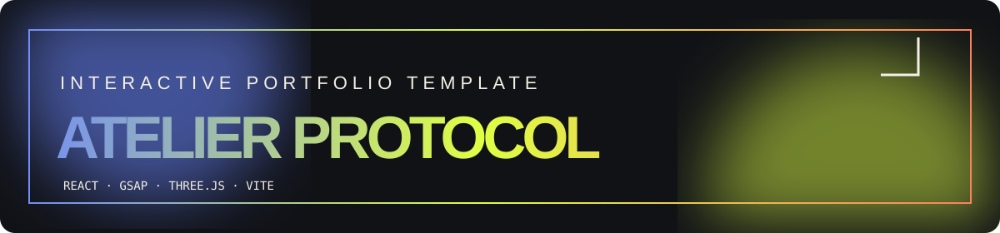

<p align="center">
  
</p>

<p align="center">
  An original, editorial portfolio starter for creative technologists and independent studios.<br />
  <strong>Responsive · keyboard-friendly · motion-aware · ready for GitHub Pages</strong>
</p>

<p align="center">
  <a href="#quick-start">Quick start</a> ·
  <a href="#customise-it">Customise</a> ·
</p>


## ✦ What this is

**Atelier Protocol** is a one-page, high-impact portfolio template. It pairs an editorial layout with small, deliberate interactions: a WebGL orbit, custom cursor, route-free modal case studies, responsive work cards, a working mail action, smooth internal navigation, and an optional micro sound feedback toggle.

It is deliberately built as an **original design system**, with editable placeholder content and a generated portrait asset. Use it as a base for your own identity, not as a finished biography.

| Layer       | Choice                                |
| :---------- | :------------------------------------ |
| Application | React 19                              |
| Tooling     | Vite                                  |
| Motion      | GSAP                                  |
| 3D sketch   | Three.js                              |
| Styling     | Hand-authored CSS — no UI framework   |
| Deployment  | Static `/docs` build for GitHub Pages |

## ◌ Experience map

```text
LOAD → INTRO → LIVE WEBGL OBJECT → MANIFESTO → INTERACTIVE METHOD DIAL
     → SELECTED WORK MODALS → PROCESS → TESTIMONIAL → CONTACT
```

- **Fully responsive:** designed from a 320 px phone width through large desktop displays.
- **Accessible defaults:** visible focus states from native controls, semantic sections, descriptive image alt text, reduced-motion support, and modal dialog semantics.
- **No invisible magic:** content is centralised in `src/data.js`; the rest is explicit React and CSS.
- **No borrowed brand assets:** all copy, naming, graphic forms, and imagery in this starter are original placeholders.


## Quick start

### 1. Prerequisites

Install the current **LTS version of Node.js** from [nodejs.org](https://nodejs.org/). Then open this folder in a terminal.

### 2. Run it locally

```bash
npm install
npm run dev
```

Vite prints a local preview address, normally `http://localhost:5173`.

### 3. Make the GitHub Pages version

```bash
npm run build
```

This project intentionally outputs the production website into **`docs/`**. Commit that folder: it is the version GitHub Pages publishes with the no-terminal method below.

> **Important:** Never upload `node_modules/`. It is only a local cache and is already excluded by `.gitignore`.

## Customise it

### Identity and projects

Begin in **`src/data.js`**. Update the owner name, email, location, featured projects, colours, years, and practice descriptions. It is the fastest way to make the template yours.

| Want to change                                            | File                                             |
| :-------------------------------------------------------- | :----------------------------------------------- |
| Hero, navigation, sections, buttons, modal wording        | `src/App.jsx`                                    |
| Portfolio facts, work cards, capability dial              | `src/data.js`                                    |
| Colours, typography, layouts, breakpoints, motion styling | `src/styles.css`                                 |
| WebGL orbit geometry and behaviour                        | `src/OrbitCanvas.jsx`                            |
| Portrait / browser icon                                   | `public/portrait-aria.png`, `public/favicon.svg` |
| SEO title and description                                 | `index.html`                                     |

### Replace the portrait

1. Put your new image in `public/` (for example `public/portrait-you.jpg`).
2. In `src/App.jsx`, replace `./portrait-aria.png` with `./portrait-you.jpg`.
3. Update the image `alt` text with a meaningful description.
4. Run `npm run build` again so `docs/` receives the new file.

### Keep the design coherent

The palette is controlled near the top of `src/styles.css`:

```css
:root {
  --ink: #101216;
  --paper: #f4f0e6;
  --lime: #dfff45;
  --blue: #6b86ff;
  --coral: #ff795e;
}
```

Change these five variables first rather than hunting through every rule.


## Preview checklist

| Preview type                        | Do this                                                                   |
| :---------------------------------- | :------------------------------------------------------------------------ |
| Before publishing, on your computer | `npm install` then `npm run dev`                                          |
| Production build, on your computer  | `npm run build`, then `npm run preview`                                   |
| Published production site           | Enable GitHub Pages from `main` / `/docs` and use the URL GitHub displays |
| File-level preview                  | Open `docs/index.html` after a build (a local server is still preferred)  |

## Project tree

```text
atelier-protocol-portfolio-template/
├── assets/                       # animated README artwork
├── docs/                         # production site uploaded to /docs on GitHub Pages
├── public/                       # website assets copied into docs during build
├── src/
│   ├── App.jsx                   # page, interactions, modal
│   ├── OrbitCanvas.jsx           # original Three.js sketch
│   ├── data.js                   # fast content editing
│   ├── main.jsx                  # React entry
│   └── styles.css                # complete responsive visual system
├── .gitignore
├── index.html
├── package.json
├── package-lock.json
└── vite.config.js
```

## Scripts

```bash
npm run dev       # local authoring server
npm run build     # create the /docs GitHub Pages build
npm run preview   # review the /docs production build locally
```

## Credits & license

Template architecture, CSS, placeholder copy, and graphical treatment are supplied for you to adapt. The included portrait is an AI-generated placeholder; replace it with a photo you have rights to use before launching a personal or client site.

**Good practice:** replace every placeholder project, link, email address, testimonial, and portrait before presenting the website as your own body of work.


<p align="center"><sub>Made for curious work. Keep the interesting bits.</sub></p>

<div align="center">

## 🌟 Support the Project

If you find this template useful, please consider giving it a star! It helps others discover the repository and supports future development.

</div>


